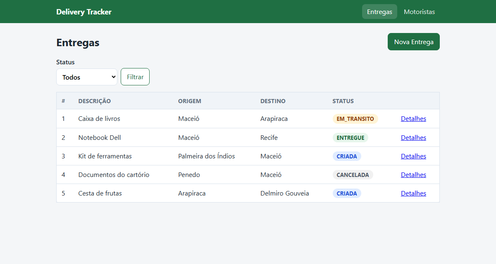
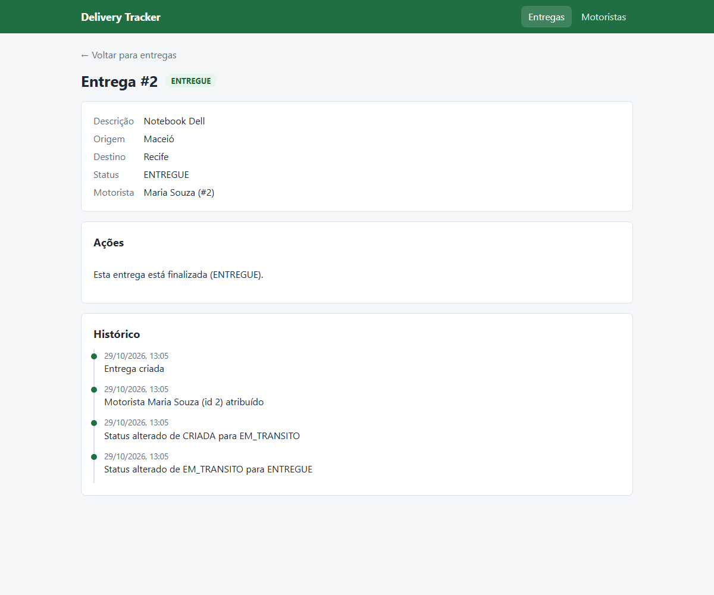

# Delivery Tracker

> **Programação Web II — IFAL/Maceió**
> Cap. 4 — Atividade 05 (Arquitetura em Camadas) e Atividade 06 (Motoristas, Contratos e DI)
> Cap. 5 — Atividade 07 (Persistência com Prisma + SQLite)
> Cap. 6 — Atividade 08 (Interface Web com SSR e EJS)
> Aluno: Fernando Gabriel · Matrícula: 2024014130

Aplicação web para rastrear o ciclo de vida de encomendas (**Entregas**) e atribuí-las a
**Motoristas**. As páginas são renderizadas no servidor com **EJS** (SSR), o código segue as camadas
**rotas → controllers → services → repositories** e os dados ficam em **SQLite** via **Prisma ORM**.



<details>
<summary>Tela de detalhe de uma entrega (status, motorista e histórico)</summary>



</details>

## Como executar

Requer **Node 18+**.

```bash
npm install                  # instala e gera o Prisma Client
cp .env.example .env         # DATABASE_URL e SESSION_SECRET
npx prisma migrate dev       # cria o banco e aplica as migrations
npm run dev                  # http://localhost:3000 (reinicia a cada alteração)
```

Abra **http://localhost:3000**: a raiz redireciona para `/entregas`.

Para subir num banco que já existe (ex.: após um `git pull` com migrations novas, ou em produção),
use `npx prisma migrate deploy && npm start`, que aplica só as migrations pendentes sem apagar dados.

### Variáveis de ambiente (`.env`)

| Variável | Exemplo | Uso |
|---|---|---|
| `DATABASE_URL` | `file:./dev.db` | banco SQLite (caminho relativo à pasta `prisma/`) |
| `SESSION_SECRET` | `mudar-em-prod` | assina o cookie da sessão (usada pelas mensagens flash) |
| `PORT` | `3000` | opcional; padrão 3000 |

### Scripts úteis

| Comando | O que faz |
|---|---|
| `npm start` | sobe o servidor |
| `npm run dev` | sobe o servidor reiniciando a cada alteração |
| `npm run check:ssr` | roda o verificador SSR (com o servidor no ar) |
| `npm run db:migrate` | `prisma migrate dev`: cria/aplica migrations em desenvolvimento |
| `npm run db:deploy` | `prisma migrate deploy`: aplica migrations pendentes |
| `npm run db:studio` | `prisma studio`: interface web para inspecionar os dados |

## Correção automática

O autograder SSR oficial da Atividade 08 ainda não foi publicado no repositório-modelo. O
`autograder/check.mjs` que veio com o projeto é o do Cap. 4 e testa a **API JSON** (`/api/entregas`,
`/api/motoristas`), que foi substituída pelas telas nesta atividade. Por isso ele não se aplica mais.

Enquanto o oficial não chega, o repositório traz um **verificador SSR próprio**
([`autograder/check-ssr.mjs`](autograder/check-ssr.mjs)), que segue o contrato de rotas do enunciado:

```bash
npm start                    # em um terminal
npm run check:ssr            # em outro → RESULTADO: 20/20 checagens
```

Ele confere, entre outras coisas: status HTTP de cada rota, PRG (`3xx` após POST/PATCH) com flash na
página seguinte, `400` com o formulário reexibido e os dados preservados, `404` em HTML, ciclo de
status, cancelamento, filtro, CPF duplicado, atribuição via `<select name="motoristaId">` e escape
de HTML (sem XSS).

A cada `git push`, o **GitHub Actions** instala as dependências, gera o Prisma Client, roda
`prisma migrate deploy`, sobe o servidor e executa esse verificador; o resultado aparece na aba
**Actions**. Quando o autograder oficial for publicado, basta colocá-lo em `autograder/check.mjs` e
trocar a última linha de [`.github/workflows/autograding.yml`](.github/workflows/autograding.yml).

## Telas e rotas

Todas as rotas devolvem **HTML**. A única rota JSON é o health check.

### Entregas

| Método | Rota | O que faz | Resposta |
|---|---|---|---|
| GET | `/` | raiz | `302` → `/entregas` |
| GET | `/entregas` | lista com filtro por status (`?status=EM_TRANSITO`) | `200` |
| GET | `/entregas/nova` | formulário de nova entrega | `200` |
| POST | `/entregas` | cria a entrega | `302` → `/entregas` com flash · `400`/`409` reexibe o form |
| GET | `/entregas/:id` | detalhe: dados, ações e histórico | `200` · `404` |
| PATCH | `/entregas/:id/avancar` | `CRIADA → EM_TRANSITO → ENTREGUE` | `302` → detalhe com flash |
| PATCH | `/entregas/:id/cancelar` | cancela a entrega | `302` → detalhe com flash |
| PATCH | `/entregas/:id/atribuir` | atribui o motorista do `<select name="motoristaId">` | `302` → detalhe com flash |

### Motoristas

| Método | Rota | O que faz | Resposta |
|---|---|---|---|
| GET | `/motoristas` | lista de motoristas | `200` |
| GET | `/motoristas/novo` | formulário de cadastro | `200` |
| POST | `/motoristas` | cadastra o motorista | `302` → `/motoristas` com flash · `400`/`409` reexibe o form |
| GET | `/motoristas/:id` | detalhe com as entregas atribuídas | `200` · `404` |

### Outras

| Método | Rota | Resposta |
|---|---|---|
| GET | `/api/health` | `200 { "status": "ok" }` |
| qualquer | rota inexistente | `404` com a página de erro |

### Como as telas funcionam

- **PRG (Post/Redirect/Get):** toda escrita que dá certo responde com redirect. Assim, recarregar a
  página não reenvia o formulário.
- **Mensagens flash:** `express-session` + `connect-flash`. A mensagem é gravada na sessão antes do
  redirect e exibida uma única vez na página seguinte (partial `flash.ejs`).
- **PATCH em formulário HTML:** o HTML só envia `GET` e `POST`. Os botões de ação enviam
  `POST /entregas/:id/avancar?_method=PATCH`, e o `method-override` troca o método para `PATCH` antes
  de chegar ao roteador, mantendo o contrato de rotas do enunciado.
- **Validação em duas etapas:**
  - o `express-validator` ([`src/middlewares/validacao.js`](src/middlewares/validacao.js)) checa
    o **formato** (campos obrigatórios e tamanho máximo); se falhar, reexibe o formulário com
    `400`, as mensagens e o que foi digitado;
  - as **regras de negócio** continuam nos services (origem ≠ destino, duplicidade, transições,
    CPF único). Quando um service recusa um formulário, o controller o reexibe com o status do
    erro; quando recusa uma ação (avançar, cancelar, atribuir), volta ao detalhe com flash de erro.
- **Erros:** o middleware [`src/middlewares/erros.js`](src/middlewares/erros.js) renderiza
  `erro.ejs` com o status do `AppError` (ex.: `404`) ou `500` com mensagem genérica. Nunca mostra
  stack trace.
- **Segurança do HTML:** todo dado do usuário é impresso com `<%= %>` (escapado); `<%- %>` só é
  usado para incluir partials e o `body` do layout.

## Arquitetura

```
server.js                          # configura o app: EJS, layout, static, sessão, flash, rotas e erros
prisma/
├── schema.prisma                  # modelos Motorista, Entrega e Evento (SQLite)
└── migrations/                    # migrations versionadas
public/
└── css/style.css                  # estilo das telas
docs/                              # prints das telas
src/
├── config/
│   └── database.js                # singleton do Prisma Client
├── middlewares/
│   ├── locals.js                  # flash, rota atual e formatarData para as views
│   ├── validacao.js               # express-validator (formato dos formulários)
│   └── erros.js                   # 404 e página de erro em HTML
├── routes/
│   ├── index.js                   # composition root: cria e injeta as dependências
│   ├── entregas.routes.js
│   └── motoristas.routes.js
├── controllers/                   # traduz HTTP ↔ service e escolhe a view (sem regra de negócio)
├── services/                      # TODA a regra de negócio
├── repositories/                  # só acesso a dados
│   ├── contracts.js               # contratos (JSDoc) IEntregasRepository / IMotoristasRepository
│   ├── entregas.repository.prisma.js
│   ├── motoristas.repository.prisma.js
│   ├── EntregasRepository.js      # implementação em memória (Cap. 4)
│   └── MotoristasRepository.js    # implementação em memória (Cap. 4)
├── database/                      # banco simulado em memória (Cap. 4)
├── utils/                         # classes de erro e enums de status
└── views/
    ├── layouts/base.ejs           # esqueleto HTML comum (express-ejs-layouts)
    ├── partials/                  # navbar, flash, badge de status, erros de formulário
    ├── entregas/                  # index, nova, detalhe
    ├── motoristas/                # index, novo, detalhe
    └── erro.ejs                   # página de erro (404, 500...)
```

- **Regra de negócio só no Service.** O controller não valida regra e o repository não decide regra.
- **Os services não mudaram com o SSR:** a troca de JSON para HTML ficou toda nos controllers, nas
  rotas e nas views.
- O **Service** lança erros de aplicação (`ValidationError` 400, `NotFoundError` 404,
  `ConflictError` 409, `BusinessRuleError` 422); o controller decide como mostrá-los na tela.
- **Só a camada de repository acessa o Prisma Client.**

### Composição das dependências (composition root)

Todo `new` de repositories, services e controllers acontece **só** em `src/routes/index.js`.

```
src/routes/index.js  (composition root)
│
├─ EntregasPrismaRepository     implementa «IEntregasRepository»   ──┐
├─ MotoristasPrismaRepository   implementa «IMotoristasRepository» ──┤
│                                                                    ▼
│                                    Prisma Client (singleton) ──▶ SQLite (prisma/dev.db)
│
├─ EntregasService(entregasRepo, motoristasRepo)
├─ MotoristasService(motoristasRepo, entregasRepo)
│
├─ EntregasController(entregasService, motoristasService) ──▶ /entregas/...
└─ MotoristasController(motoristasService)                ──▶ /motoristas/...

Fluxo de uma requisição:
  rota ──▶ [validação] ──▶ controller ──▶ service ──▶ «contrato» repository ──▶ Prisma ──▶ SQLite
                              │
                              └──▶ res.render(view) ou res.redirect (PRG)
```

```js
const entregasRepo      = new EntregasPrismaRepository();
const motoristasRepo    = new MotoristasPrismaRepository();
const entregasService   = new EntregasService(entregasRepo, motoristasRepo);
const motoristasService = new MotoristasService(motoristasRepo, entregasRepo);
const entregasController   = new EntregasController(entregasService, motoristasService);
const motoristasController = new MotoristasController(motoristasService);
```

O `EntregasController` recebe também o `MotoristasService` para montar o `<select>` de motoristas
ativos e mostrar o nome do motorista no detalhe da entrega.

Trocar a persistência continua sendo trocar **uma linha por repository**: a versão em memória do
Cap. 4 segue disponível (`new EntregasRepository(new Database())`).

### Contratos de Repository

Documentados em JSDoc em [`src/repositories/contracts.js`](src/repositories/contracts.js). Os
services dependem só desses contratos, então qualquer objeto que os cumpra (um mock, a versão em
memória ou a versão Prisma) pode ser injetado. Os métodos podem devolver o valor direto ou uma
`Promise` (os services sempre usam `await`).

```
// IEntregasRepository
listarTodos(filtros?)  → Entrega[]          // filtros: { status?, motoristaId? } (combinados)
buscarPorId(id)        → Entrega | null
criar(dados)           → Entrega
atualizar(id, dados)   → Entrega

// IMotoristasRepository
listarTodos()          → Motorista[]
buscarPorId(id)        → Motorista | null
buscarPorCpf(cpf)      → Motorista | null
criar(dados)           → Motorista
```

## Banco de dados (Prisma + SQLite)

- **Configuração:** `DATABASE_URL` no `.env` (modelo em [`.env.example`](.env.example)). O caminho
  é relativo à pasta `prisma/`, então `file:./dev.db` cria `prisma/dev.db`.
- **Schema** ([`prisma/schema.prisma`](prisma/schema.prisma)):

  | Modelo | Tabela | Observações |
  |---|---|---|
  | `Motorista` | `motoristas` | `cpf` **único**; `placaVeiculo` opcional; `status` padrão `ATIVO` |
  | `Entrega` | `entregas` | `motoristaId` opcional (relação com `Motorista`); índices em `status` e `motoristaId` |
  | `Evento` | `eventos` | histórico da entrega (`data`, `descricao`); apagado junto com a entrega |

- **Histórico:** fica na tabela `eventos`; os repositories o devolvem como
  `historico: [{ data, descricao }]` (data em ISO), e a view formata a data em `pt-BR`.
- **Migrations:** versionadas em `prisma/migrations/`. Para alterar o schema, edite
  `schema.prisma` e rode `npx prisma migrate dev --name <descricao>`.
- **Persistência:** cadastre algo pelas telas, pare o servidor (Ctrl+C), suba de novo e os dados
  continuam lá.
- **Inspecionar os dados:** `npx prisma studio`.
- **Fora do git:** `.env`, `prisma/*.db` e `node_modules/` (ver `.gitignore`).

## Modelo de domínio

### Entrega

| Campo | Tipo | Observação |
|---|---|---|
| `id` | number | gerado |
| `descricao` | string | obrigatório (até 200 caracteres) |
| `origem` | string | obrigatório; ≠ `destino` |
| `destino` | string | obrigatório |
| `status` | enum | `CRIADA` → `EM_TRANSITO` → `ENTREGUE`; ou `CANCELADA` |
| `motoristaId` | number \| null | `null` ao criar; preenchido na atribuição |
| `historico` | Evento[] | `{ data, descricao }` |

### Motorista

| Campo | Tipo | Observação |
|---|---|---|
| `id` | number | gerado |
| `nome` | string | obrigatório |
| `cpf` | string | obrigatório; único |
| `placaVeiculo` | string \| null | opcional |
| `status` | enum | `ATIVO` (padrão) \| `INATIVO` |

## Regras de negócio

Cada regra violada aparece como mensagem na própria tela, nunca como página quebrada.

| Regra | Onde aparece quando é violada |
|---|---|
| `descricao`, `origem` e `destino` obrigatórios | form reexibido (`400`) |
| `origem ≠ destino` | form reexibido (`400`) |
| sem entrega **ativa** duplicada (mesma descrição, origem e destino) | form reexibido (`409`) |
| transições só `CRIADA → EM_TRANSITO → ENTREGUE` | flash de erro no detalhe |
| cancelar só se não estiver `ENTREGUE` nem `CANCELADA` | flash de erro no detalhe |
| `nome` e `cpf` do motorista obrigatórios | form reexibido (`400`) |
| CPF único | form reexibido (`409`) |
| atribuir só entrega `CRIADA` a motorista `ATIVO` | flash de erro no detalhe |

Toda criação, transição e atribuição registra um evento no histórico da entrega. Na tela de
detalhe, os botões só aparecem quando a ação faz sentido para o status atual, mas quem garante a
regra é o service: uma requisição feita "por fora" da tela também é recusada.
